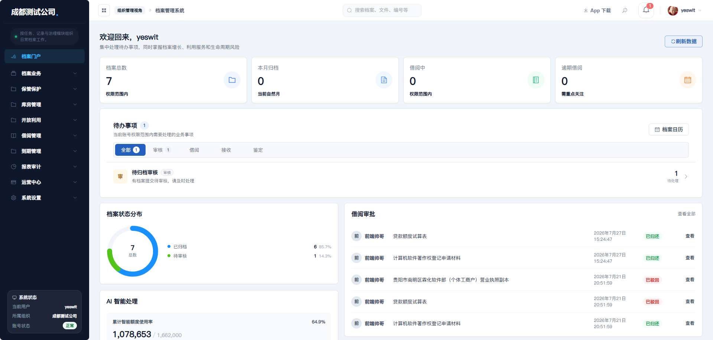
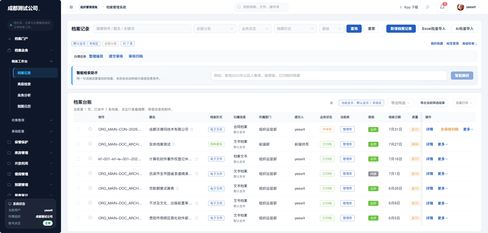
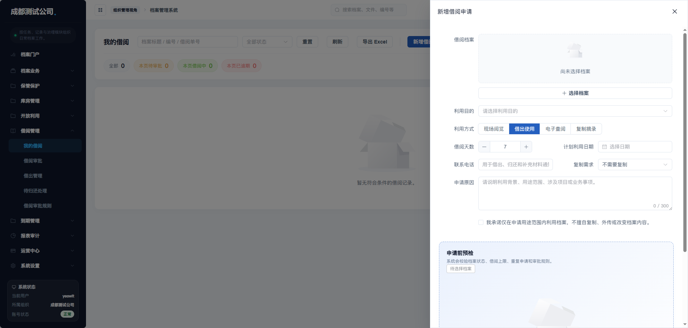
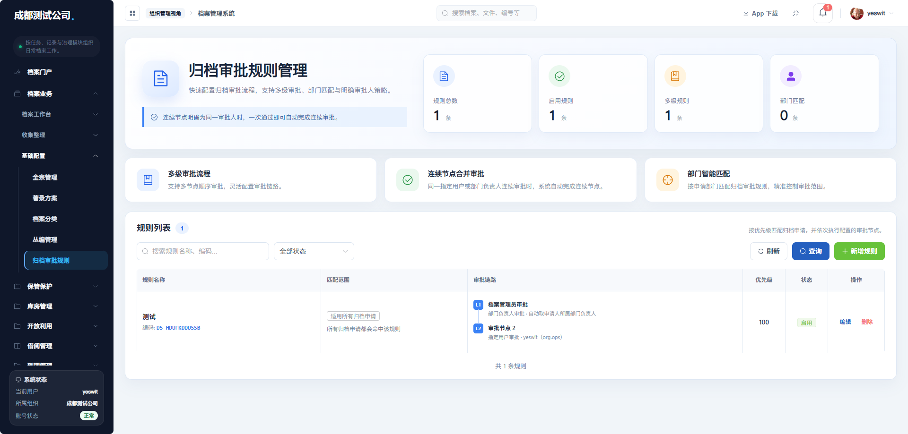
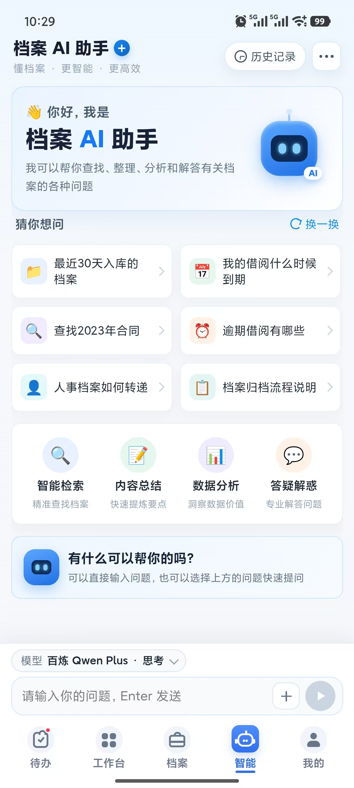
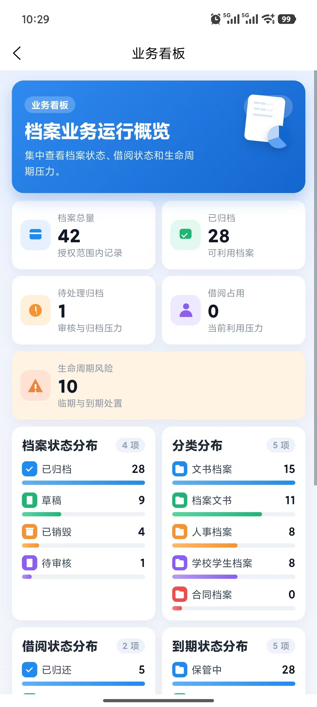
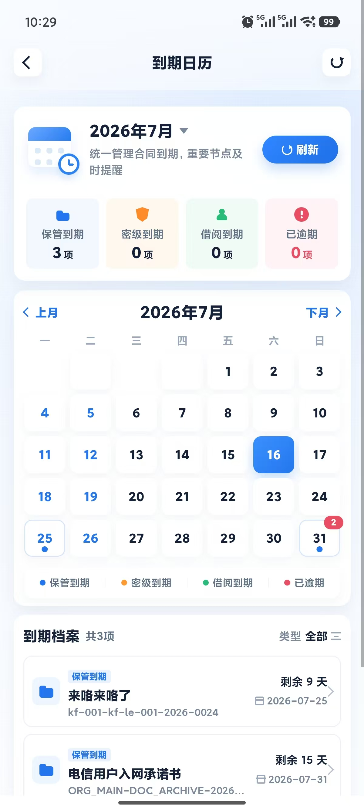
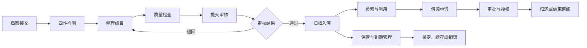
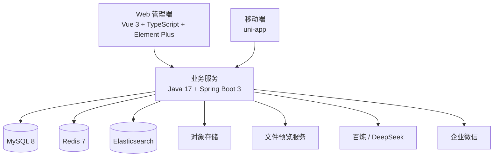
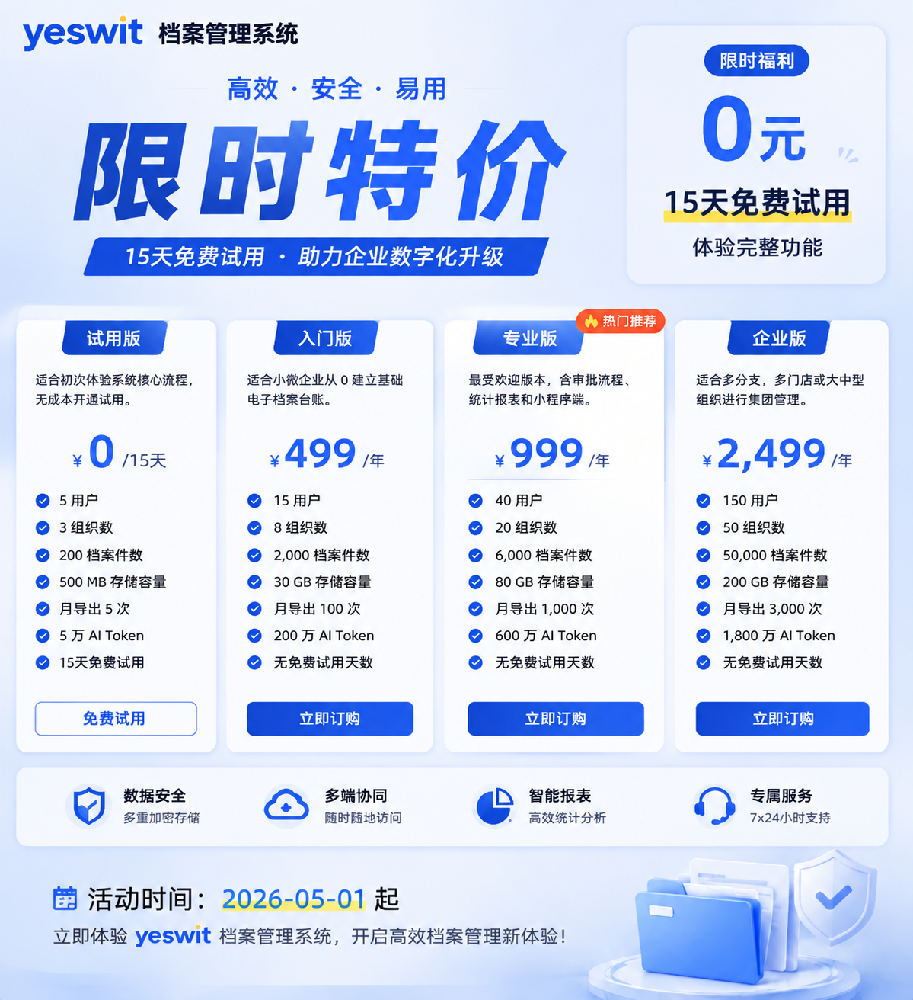

<div align="center">

# YESWIT 档案管理系统

### 面向企业与组织的数字档案全生命周期管理平台

将档案接收、整理编目、审核归档、智能检索、借阅利用、保管鉴定与长期保存集中在一套系统中，让档案业务更高效、更安全、更容易追溯。

[](https://www.oracle.com/java/)
[](https://spring.io/projects/spring-boot)
[](https://vuejs.org/)
[](https://www.typescriptlang.org/)
[](https://www.mysql.com/)
[](https://www.docker.com/)
[](./LICENSE)

[官方网站](https://www.yeswit.top) · [申请产品演示](mailto:admin@yeswit.top?subject=申请%20YESWIT%20档案管理系统演示) · [使用手册](./docs/option/01-使用手册.md) · [常见问题](./docs/option/02-常见问题.md)

如果项目对你的档案数字化建设有参考价值，欢迎 Star 关注产品更新。

</div>

---

<div align="center">
  
</div>

## 产品介绍

YESWIT 是一套覆盖 Web 管理端与移动端的企业级数字档案管理系统，适用于企业、事业单位、学校以及集团型组织的档案集中管理场景。

系统围绕档案业务中的“收、管、存、用”建立完整闭环，将分散在文件夹、表格、纸质台账和多个业务部门中的档案统一纳入可配置、可审批、可检索、可审计的管理体系。

在传统档案管理能力之上，YESWIT 将 AI 融入建档、分类、检索、审核和数据分析流程，并通过多租户隔离、角色权限、数据范围、档案密级与操作日志保障组织数据安全。

## 核心价值

| 价值方向 | 解决的问题 | YESWIT 提供的能力 |
| --- | --- | --- |
| 业务集中 | 档案散落在部门、个人电脑和纸质台账中 | 统一档案台账、全宗、分类、方案和业务入口 |
| 流程规范 | 归档、借阅和鉴定依赖人工沟通 | 可配置审批规则、待办中心、消息提醒和流程记录 |
| 查找高效 | 档号不清楚、关键词不准确时难以查找 | 条件检索、全文检索、自然语言解析和 AI 问答 |
| 风险可控 | 权限粗放、敏感档案容易被越权访问 | 角色权限、数据范围、密级许可、水印与安全预览 |
| 生命周期治理 | 归档后缺少到期、鉴定和销毁管理 | 到期日历、保管期限、鉴定会签、销毁和长期保存 |
| 多端协同 | 外出或移动场景无法及时审批和查档 | Web 管理端、Android 与 HarmonyOS 移动端 |

## Web 端展示

### 统一工作台与待办中心

README 首屏展示的工作台集中呈现档案总量、本月归档、借阅状态、逾期风险、待办事项和业务分布。不同角色登录后看到与自身权限和职责匹配的业务入口。

### 档案台账与智能检索

档案记录页面支持组合筛选、快速查询、高级检索、收藏标签、批量导入、批量导出和 AI 批量建档。用户也可以输入自然语言，由系统转换为结构化检索条件。

<div align="center">
  
</div>

### 借阅审批与利用管理

围绕电子档案和实体档案建立申请、审批、借出、授权、归还、续借、催还和逾期处理流程。管理人员可以集中查看当前申请、审批状态和档案利用信息。

<div align="center">
  
</div>

### 可配置归档审批规则

支持多节点顺序审批、指定用户审批、部门负责人审批、部门智能匹配、规则优先级和启停管理。组织可以根据自身制度配置归档流程，无需将审批逻辑固定在代码中。

<div align="center">
  
</div>

> 截图内容均为演示数据。实际页面、菜单和可执行操作由用户类型、角色权限、数据范围、档案密级及订阅方案共同决定。

## 移动端展示

移动端覆盖待办、工作台、档案检索、扫码查档、AI 助手、借阅申请、归档审批、移交接收、档案证明和到期提醒等常用场景。

<div align="center">
  
  
  
</div>

<div align="center">
  <sub>AI 智能助手 · 业务运行看板 · 档案到期日历</sub>
</div>

## 功能全景

### 档案基础配置

- 全宗管理：维护全宗信息、责任部门和管理范围
- 著录方案：配置不同档案类型的字段、必填规则和展示方式
- 档案分类：构建组织自己的档案分类体系
- 编号规则：按组织制度自动生成档号并提供编号预览
- 保管期限：配置到期规则、预警时间和处置策略
- 数据字典：集中维护密级、开放程度、载体类型等基础数据

### 档案接收与整理

- 移交接收与接收批次管理
- 电子档案四性检测
- 接收建档和整理编目
- Excel 批量导入与导入前校验
- AI 文本建档、附件建档和批量建档
- 质量检查、整理状态和问题反馈

### 归档与审核

- 提交审核、审核通过、驳回和退回修改
- 多级归档审批规则
- 指定人员、部门负责人和部门匹配审批
- 审批进度、审批历史和流程节点展示
- 批量整理、批量提交和批量归档
- 档案版本记录与版本差异比较

### 检索与利用

- 关键词、档号、题名、分类、状态和密级检索
- 高级组合筛选与全文检索
- 自然语言检索条件解析
- 档案收藏、标签和最近访问
- 开放目录与公开档案门户
- 检索分析、热门档案和利用统计

### 借阅管理

- 电子档案与实体档案借阅申请
- 多级借阅审批和审批规则配置
- 实体档案借出确认与交接
- 电子档案审批后授权访问
- 我的借阅、续借、归还和结束借阅
- 待归还、催还和逾期管理

### 保管与库房

- 档案盒与库位管理
- 库房人员出入记录
- 温湿度登记、统计和异常关注
- 实体档案保管记录
- 实体与系统台账一致性检查
- 电子档案分库和安全预览

### 鉴定、销毁与长期保存

- 保管期限到期提醒和到期日历
- 档案鉴定申请、会签与处置意见
- 延长保管、开放审核和销毁审批
- 销毁清册和生命周期记录
- 文件格式检查、格式转换和长期保存
- 档案证明申请、审批与电子证明下载

### 组织与平台治理

- 多租户组织隔离
- 部门、用户、角色和菜单权限
- 数据范围与档案密级许可
- 企业品牌和组织信息配置
- 登录日志、在线用户和强制下线
- 公告、消息、工单、反馈和平台运营

## AI 能力

YESWIT 的 AI 不是独立的聊天装饰，而是嵌入档案业务流程的效率工具。

| AI 场景 | 主要作用 |
| --- | --- |
| 智能建档 | 从文本、图片或附件中提取题名、日期、责任人、关键词等信息 |
| 智能分类 | 根据档案内容提供分类、方案和字段填写建议 |
| 自然语言检索 | 将“查找 2025 年以后已归档的合同”解析为检索条件 |
| 档案问答 | 围绕用户有权访问的档案进行查询、总结和分析 |
| 审核辅助 | 对档案完整性、著录质量和归档内容提供辅助意见 |
| 报表解读 | 对业务指标、档案分布和利用情况生成分析说明 |
| 知识库 | 管理业务文档、知识分块和面向场景的智能问答 |
| 多模型管理 | 支持百炼 Qwen、DeepSeek 等模型配置与业务场景绑定 |

AI 调用会校验用户权限、数据范围和档案密级。模型能力、数据处理边界与使用费用取决于具体部署和配置方案。

## 安全与权限体系

档案系统不应只解决“存进去”，还必须解决“谁能看、能看什么、做过什么”。YESWIT 在多个层面执行权限控制：

- 租户隔离：不同组织的数据和业务配置相互隔离
- 角色权限：菜单、页面、按钮和接口按角色授权
- 数据范围：支持全部、本部门、本部门及下级、仅本人等范围
- 密级许可：用户只能访问不高于自身许可级别的档案
- 业务校验：检索、详情、附件预览、AI 和借阅都会执行权限检查
- 安全预览：支持文件预览、水印、访问控制和预览签名
- 操作审计：记录登录、查询、导入、导出、审批和管理操作
- 数字签名：支持签名验证、续签和证据包下载等可信能力

## 典型业务流程



## 适用场景

| 场景 | 典型需求 |
| --- | --- |
| 企业综合档案 | 行政、合同、项目、财务、资质和知识产权档案统一管理 |
| 人事档案 | 人员材料、证明出具、密级控制和借阅审批 |
| 学校档案 | 学生、教学、行政、科研及合同档案分类管理 |
| 集团型组织 | 多组织、多部门、多角色和跨层级数据范围治理 |
| 档案室与库房 | 实体档案盒、库位、温湿度、出入和盘点管理 |
| 数字档案建设 | 电子文件接收、四性检测、长期保存和安全利用 |
| 内网私有化 | 对数据本地化、网络隔离和定制集成有要求的组织 |

## 技术架构



### 技术组件

- 后端：Java 17、Spring Boot 3.3、MyBatis Plus、WebSocket
- Web 前端：Vue 3、TypeScript、Element Plus、Vite、Pinia
- 移动端：uni-app、Android、HarmonyOS
- 数据与缓存：MySQL 8、Redis 7
- 检索服务：Elasticsearch
- 文档处理：Apache Tika、Apache POI、PDFBox、kkFileView
- 对象存储：本地存储或阿里云 OSS
- 外部集成：企业微信、支付宝、微信支付
- 工程交付：Docker Compose、GitHub Actions

## 项目结构

```text
archive/
├─ backend/       # Spring Boot 后端服务
├─ web/           # Vue 3 Web 管理端
├─ app_uni/       # Android / HarmonyOS 移动端
├─ docs/          # 产品图片、使用手册和操作流程
├─ deploy/        # 部署配置与运维资料
└─ README.md
```

## 部署与交付

YESWIT 可根据组织规模、数据敏感程度和二次开发需求提供不同交付方式。

| 方式 | 适用对象 | 交付说明 |
| --- | --- | --- |
| 产品演示 | 正在进行产品选型的团队 | 通过演示数据体验建档、审批、检索和借阅流程 |
| SaaS 服务 | 希望快速上线的中小团队 | 无需自建基础设施，按订阅方案使用 |
| 私有化部署 | 对内网部署和数据隔离有要求的组织 | 部署到客户服务器、私有云或指定基础设施 |
| 源码授权 | 需要深度集成与长期二次开发的团队 | 根据合同提供源码、部署资料和技术交付 |
| 定制开发 | 需要接入现有 OA、ERP、HR 或业务系统的组织 | 根据业务边界评估接口、流程和数据迁移方案 |

> 本项目属于商业软件。初始化数据、生产配置、部署资料和技术支持将根据授权方案交付，请勿将仓库中的示例配置直接用于生产环境。

## 版本与定价

YESWIT 提供从免费试用到企业级使用的多档 SaaS 套餐。套餐按照用户数、组织数、档案件数、存储容量、月导出次数和 AI Token 额度进行区分。

| 版本 | 价格 | 用户 / 组织 | 档案与存储 | 适合场景 |
| --- | ---: | --- | --- | --- |
| 试用版 | 0 元 / 15 天 | 5 用户 / 3 组织 | 200 件 / 500 MB | 初次体验系统核心流程 |
| 入门版 | 499 元 / 年 | 15 用户 / 8 组织 | 2,000 件 / 30 GB | 小微企业建立基础电子档案台账 |
| 专业版 | 999 元 / 年 | 40 用户 / 20 组织 | 6,000 件 / 80 GB | 需要审批、统计和移动端能力的组织 |
| 企业版 | 2,499 元 / 年 | 150 用户 / 50 组织 | 50,000 件 / 200 GB | 多分支、多部门或中大型组织集中管理 |

<div align="center">
  
</div>

私有化部署、源码授权、数据迁移和定制集成根据服务器环境、使用规模和交付范围单独报价。套餐价格、资源配额、活动时间与服务内容可能调整，购买前请以官方网站和正式合同为准。

## 常见问题

<details>
<summary><strong>这是开源项目吗？</strong></summary>

不是。YESWIT 是商业软件，仓库内容、源码、部署包和文档均受商业许可协议保护。

</details>

<details>
<summary><strong>是否支持私有化部署？</strong></summary>

支持。可以根据客户基础设施部署到指定服务器、私有云或内网环境，具体依赖组件和交付范围需在方案阶段确认。

</details>

<details>
<summary><strong>是否支持移动端？</strong></summary>

支持 Web 管理端、Android 和 HarmonyOS。移动端适合查档、审批、借阅、移交接收、到期查看和 AI 助手等场景。

</details>

<details>
<summary><strong>AI 是否会绕过档案权限？</strong></summary>

不会。AI 检索和业务工具与普通档案接口一样，需要校验登录用户、租户、角色、数据范围和档案密级。

</details>

<details>
<summary><strong>是否可以对接现有系统？</strong></summary>

可以根据授权方案提供 API、数据交换和定制集成服务。对接范围、数据标准和同步方式需要结合现有系统评估。

</details>

## 产品文档

- [系统使用手册](./docs/option/01-使用手册.md)
- [常见问题](./docs/option/02-常见问题.md)
- [业务操作流程](./docs/option/03-操作流程.md)

## 商业合作

申请演示或咨询方案时，建议提供以下信息，以便更快完成需求匹配：

- 组织类型与预计使用人数
- 现有档案数量和年度增量
- 电子档案、实体档案或混合管理需求
- 是否需要内网、私有云或本地部署
- 是否需要 AI、企业微信、单点登录或第三方系统集成
- 期望上线时间与定制范围

联系方式：

- 官方网站：[https://www.yeswit.top](https://www.yeswit.top)
- 商务邮箱：[admin@yeswit.top](mailto:admin@yeswit.top)

<details>
<summary><strong>微信咨询</strong></summary>

<br />


</details>

## 许可说明

YESWIT 为商业软件，源码、部署包及相关文档均受版权保护。未经书面授权，不得使用、复制、修改、分发、转售、反编译或用于其他商业项目。

完整条款请查看 [LICENSE](./LICENSE)。如需试用、私有化部署、源码授权或定制开发，请通过上述联系方式咨询。

---

<div align="center">

**YESWIT 档案管理系统**

让档案管理从分散台账走向统一、智能与可信。

[申请产品演示](mailto:admin@yeswit.top?subject=申请%20YESWIT%20档案管理系统演示) · [访问官方网站](https://www.yeswit.top)

Copyright © 2025-2026 Yeswit. All rights reserved.

</div>
